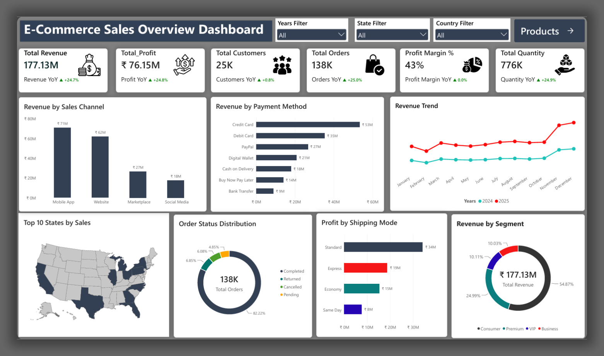
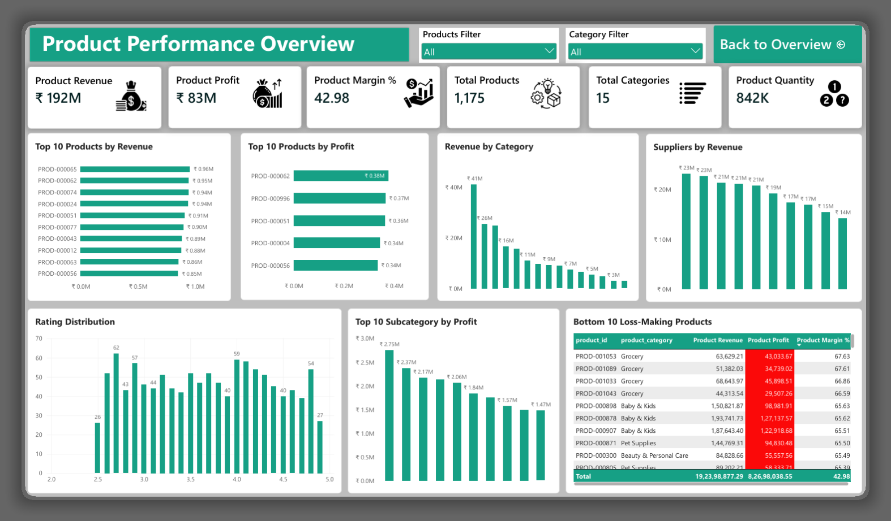

# E-Commerce Sales & Product Performance Dashboard

End-to-end data analysis project using SQL and Power BI on e-commerce data — analyzing sales, revenue, customers, product performance, and order trends.

---

## 🛠️ Tools Used

- **PostgreSQL** — Data analysis
- **Power BI** — Interactive dashboard

---

## 📊 Dashboard Preview

### Dashboard 1: E-Commerce Sales & Customers

### Dashboard 2: Product Performance

---

## 📈 Key Metrics

### Sales Dashboard
| Metric | Value | YoY Growth |
|--------|-------|-----------|
| Total Revenue | ₹177.13M | ▲ +24.7% |
| Total Profit | ₹76.15M | ▲ +24.8% |
| Total Customers | 25K | ▲ +0.8% |
| Total Orders | 138K | ▲ +25.0% |
| Profit Margin % | 43% | ▲ 0.0% |
| Total Quantity | 776K | ▲ +24.9% |

### Product Dashboard
| Metric | Value |
|--------|-------|
| Product Revenue | ₹192M |
| Product Profit | ₹83M |
| Product Margin % | 42.98 |
| Total Products | 1,175 |
| Total Categories | 15 |
| Product Quantity | 842K |

---

## 📊 Visuals

### Dashboard 1: Sales
- Revenue by Sales Channel
- Revenue by Payment Method
- Revenue Trend (2024 vs 2025)
- Top 10 States by Sales (Map)
- Order Status Distribution
- Profit by Shipping Mode
- Revenue by Segment

### Dashboard 2: Products
- Top 10 Products by Revenue
- Top 10 Products by Profit
- Revenue by Category
- Suppliers by Revenue
- Rating Distribution
- Top 10 Subcategory by Profit
- Bottom 10 Loss-Making Products

---

## 💡 Key Insights

### Sales Performance
- Mobile App is the top sales channel (₹71M)
- Credit Card is the preferred payment method (₹53M)
- 82.22% orders completed successfully
- Consumer segment dominates (54.87%)
- Revenue grew 24.7% YoY

### Product Performance
- Top product generates ₹0.96M in revenue
- Product margin is 42.98% — healthy
- Grocery category dominates but has loss-making products

---

## 📁 Files

| File | Description |
|------|-------------|
| `README.md` | Project documentation |
| `ecommerce_analysis.sql` | SQL analysis queries |
| `dashboard_1_sales.png` | Sales dashboard screenshot |
| `dashboard_2_products.png` | Product dashboard screenshot |
| `ecommerce_dashboard.pdf` | Dashboard PDF export |
| `ecommerce_dashboard.pbix` | Power BI source file |

---

## 👤 Author

**Saklain Alam**  
Data Analyst | SQL | Power BI | Python | Excel
